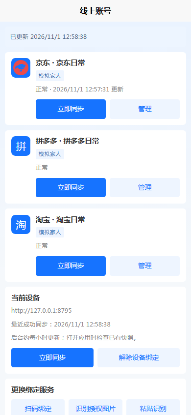
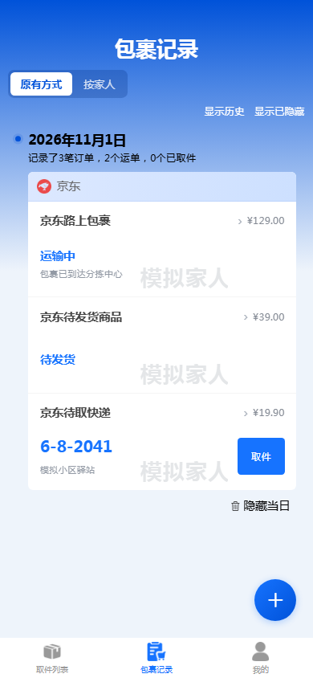

# App 3.1.11：京东展示与新增账号刷新

服务端3.1.9已支持京东买家订单。此前已发布的App3.1.10没有包含这次京东名称和图标补充；3.1.11将它们交付到安装包。包裹、家人分组、物流和取件继续使用现有协议及界面。

线上账号页此前打开时只读取本地缓存，后台新增或调整账号后可能暂时仍显示旧列表。现在先展示已有缓存，再读取后台最新快照；这次读取不会主动触发平台采集，离线保留原账号和本地记录。

## 账号没有出现时

后台账号与设备授权是两件事。请在后台「设备管理」选择正在使用的手机，勾选京东账号所属家人，并点击「保存授权」。保存后应显示对应家人及当前包含的账号数量。旧设备原来的淘宝、拼多多指定账号授权范围固定，不会自动扩权；家人整组授权才持续包含以后新增账号。无需解除设备或重新绑定。

App「我的 → 线上账号 → 立即同步」后，即使京东还没有可导入订单，也应显示京东账号。包裹记录仅显示采集到的有效记录，不把已完成、取消或非实物历史订单作为新快递导入。取件码仍以平台实际返回为准。

## 安装

版本为3.1.11 / 30111，沿用原包名及签名，可从「我的 → 检查更新」或[本次Release](https://github.com/zsdd2/kdyzm/releases/tag/app-v3.1.11)覆盖安装，保留现有绑定和记录。后台已是3.1.9时，无需为本次App更新重建容器。

APK为44,613,140字节，保留四种CPU架构、原生库压缩及离线扫码/中文OCR，没有新增依赖。App源码仍保留在原工作区，本仓库通过Release提供安装包、更新清单与校验文件。

## 验证

完整七项门禁通过，证据TASK-022-1793508754521-47de36ca：158项App测试、119项服务端镜像兼容测试、生产H5、Android资源同步、Android构建/JVM/lint、敏感文本扫描与策略检查。新增回归先复现账号页不读取最新快照，再验证修复；另覆盖家人授权后新增无订单京东、待发货/运输中/待取件导入，以及旧单账号权限边界。

390px浏览器使用纯内存模拟后台，经过页面核验/确认绑定，验证三个平台账号、京东名称图标、重新进入账号页读取快照，以及京东三种包裹状态，无本轮控制台错误。以下均为模拟数据截图：

原签名与版本递增由发行脚本验证；系统覆盖安装、手机启动器及真实待取京东包裹仍需真机验收。没有运行nightly扫描。
