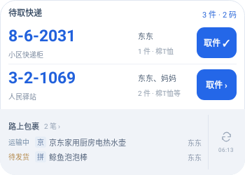

# App 3.1.12：京东路上状态与平台小标

本轮App版本为`3.1.12` / `30112`，服务端保持3.1.9。

京东订单已出现在包裹记录中，大号桌面卡片的“路上包裹”仍可能缺席：此前未识别无运单的“等待出库”“正在出库”，以及显示“暂无物流轨迹”的“待收货”。本轮将前两种状态归为待发货；待收货暂无物流轨迹时，有无运单均显示运输中。已有运输中记录继续按统一规则显示，平台不作为筛选条件。

路上区每行在状态后显示淘／拼／京小标，商品名按Unicode字符保留前10字，不加省略号；包裹记录页保留完整名称。隐私模式同时隐藏平台小标、商品名和家人信息。布局沿用已确认A稿的上下两区、比例和容量规则。

路上区继续排除已签收、已归档、取消、隐藏及助手已领取的记录；同一订单仍有运输中运单时，按未完成部分显示。

## 升级

沿用原包名及签名。发布为Latest后，可从「我的 → 检查更新」或[最新App Release](https://github.com/zsdd2/kdyzm/releases/latest)覆盖安装。保留原绑定及记录，升级后打开一次App或点击组件刷新，使已有桌面卡片更新。

服务端保持3.1.9，本次App更新无需重新部署NAS。没有新增依赖。

APK原签名校验已通过，大小为44,832,928字节，SHA256为：

```text
aecbc9069a034f655a9ff7621d7ae05d9437f1540643c581bc812a38909e8a13
```

## 验证

已使用合成数据沿完整采集、Store、组件核心、原生组件及预览链路定位上述状态缺口，并确认已有运输中记录不会按平台过滤。

`npm run verify:full -- --task TASK-023`七项门禁全部通过，证据`TASK-023-1793513835721-a4ae7421`：163项App回归、119项服务端镜像兼容回归、92项Android/JVM测试（含4项实际RemoteViews渲染、28项WidgetModel测试），以及生产H5、资源同步、Android构建/lint、敏感文本扫描及项目策略检查。

原生截图已检查350×250dp及280×180dp、字体130%场景。下图由实际Android RemoteViews资源渲染，使用合成数据：



390px浏览器预览已验收京东出库/待收货、三平台短标、十字与emoji、隐私隐藏；无横向溢出和控制台错误。OPPO启动器显示及系统覆盖安装尚未真机验收。
