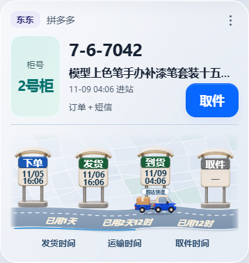
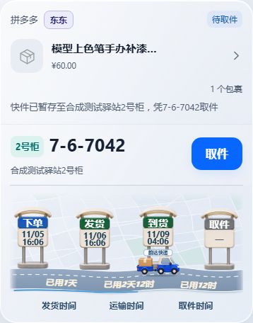
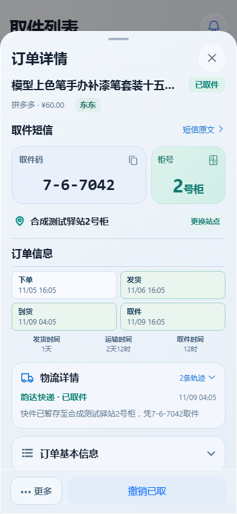

# 微缩站台物流进度

用户完整效果图为视觉定稿；原始透明素材原样复用，日期、品牌和耗时由实际数据渲染。

[Figma 定稿](https://www.figma.com/design/8vZ33CfpH5T718wSficdf0?node-id=113-2) · [动效规则](https://www.figma.com/design/8vZ33CfpH5T718wSficdf0?node-id=113-4)

以下为本轮运行界面的合成数据截图，不含真实订单和短信。

浏览器验证覆盖六种宽度、实际领取流程、站牌经过才亮、有限行驶、轮转、0.3秒路面喷字及完成后0.8秒停留。首次打开静态定位、重复同步不重播、连续新事件和撤销、减少动画模式有自动化回归覆盖。

完整发布门禁通过：App 679项、后台629项，均无跳过；Android构建、单元测试和lint通过。未完成OPPO实体手机安装和运行验收。
