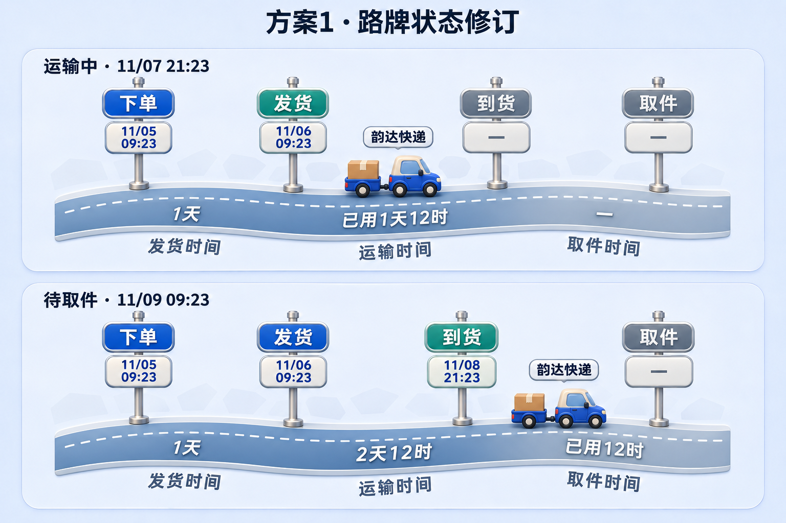
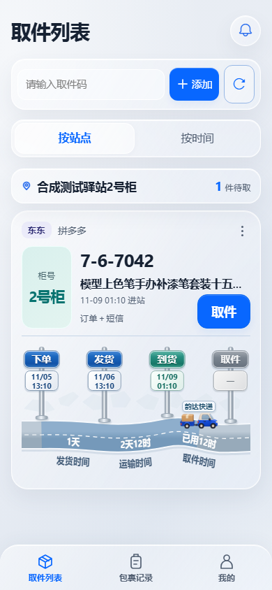
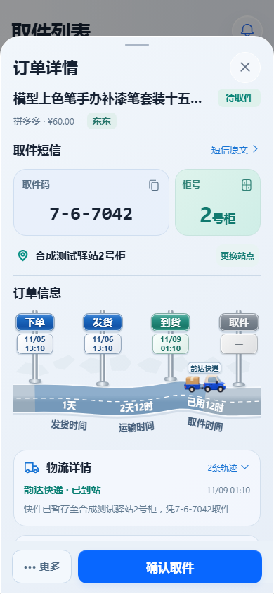

# 包裹路牌时间轴

取件列表、包裹记录和订单详情共用新的公路组件：四块烤漆单柱路牌立在道路上方，每块路牌下有独立日期时间牌。小车在上车道，耗时显示在下车道，“发货时间、运输时间、取件时间”沿道路下缘排列。更换站点按钮与站点名称同行居中，长站名可以换行。

本次发行目标为 **App 3.1.40 / 30140**，配套后台 **3.1.36** 内置新版APK，业务接口和数据库不变。安装包入口为 [App 3.1.40 Release](https://github.com/zsdd2/kdyzm/releases/tag/app-v3.1.40)，更新步骤见 [升级说明](../../road-signs-3.1.40.md)。Chrome插件保持1.2.0。

[已批准的 Figma 对照稿](https://www.figma.com/design/8vZ33CfpH5T718wSficdf0?node-id=111-2)

## 时间与状态

- 只有实际到达或已实际经过的节点点亮。较早节点蓝色，当前节点青绿，未来路牌和日期牌为灰色。
- 小车沿当前阶段按 2 天待发货、3 天运输、1 天待取件计算比例，超期停在阶段末端，不能据此确认下一实际节点。
- 发货耗时为发货减下单，运输耗时为到货减发货，取件耗时为取件减到货。进行中显示“已用”，并使用所有道路卡片共用的一分钟时钟更新。
- 缺失日期显示“—”；日精度、短信代理时间、时间逆序等不足以计算的情况不制造耗时。只有取件记录而没有订单的包裹仍可显示实际进度，历史日期保持未知。
- 保留原蓝色小车素材、承运商名称、有限时长动效和系统减少动效适配。完成记录继续使用原有紧凑摘要。

## 实现阶段验证记录

路牌改动在上一轮实现验收（TASK079）已通过完整 `verify:full`：656 项 App 测试、626 项后台测试、258 项 Android 单元测试，H5 构建、Android debug 打包与 lint、密钥扫描均通过。浏览器使用隔离合成数据，检查 320/360/390/430/768/1280px、取件与订单详情实际更换站点、长取件码不换行、长站名对齐、四阶段和未知/退回状态、小车三处车轮接地点、SVG 曲线文字实际渲染及多个卡片路径独立。这些是实现阶段的记录；App 3.1.40 / 后台 3.1.36 的发布门禁和公开制品校验以本轮实际发布记录为准。

用于公开仓库 CI 的合成时间逻辑回归在 `test/app-parcel-journey.test.mjs`，19 项通过；不含私人短信或订单样本。道路动效只使用 transform/opacity，遵循 Motion 指南的 “Prefer to animate `opacity` and `transform`”，避免逐帧布局计算。

本轮不代为部署 NAS。尚未连接实体手机验证；上述实现阶段未运行 nightly 中的 Semgrep/npm audit。已有测试工具的 Vue/SQLite 提示及 Android lint 基线警告仍保留，不能把它们称为零警告。
