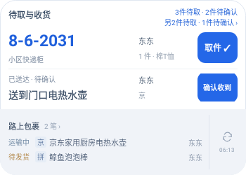
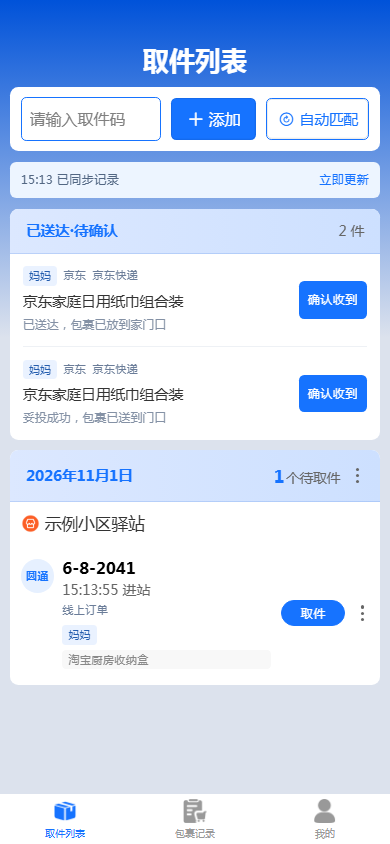

# 送货到家的收货确认

服务端3.1.11，配套App3.1.14 / 30114。

## 使用

已明确送达、妥投或放门口且没有当前有效取件码的包裹，在首页、记录页和大组件显示“已送达·待确认”。点击“确认收到”只完成这一件助手内的包裹；同一订单的所有包裹都确认后才全部完成。记录页可撤销，大组件提供7秒快捷撤销。不会向淘宝、拼多多、京东发送平台确认收货操作。

保持原页面样式与大组件A稿两区。上区优先保留取件码，同时容纳待确认收货；有更多包裹时显示未展示数量。隐私模式隐藏商品、家人及平台。原45天归档、隐藏、删除和设备授权继续生效；归档历史不会重新涌入首页或组件。

京东已有有效运单号时，默认显示“运输中”，包括仍在出库或只有打印事件的包裹；实际最新轨迹仍完整保留。到站、已送达及人工已收货优先，无运单仍可显示待发货。此规则只作用于京东，其他平台保留原状态边界。

## 识别与兼容

三平台采集统一识别完成送达节点，仍使用已有 `signed` 状态和 `pick/restore` 操作。正在派送、预计／未送达、派送失败和普通“送货上门”要求不算已送达。驿站／代收点／快递柜目的地优先按到站处理，包括“已送到菜鸟驿站门口”；没有取件码时继续等待码。

App从已有快照派生 `isHomeDelivery` 和 `needsReceiptConfirmation` 展示字段，不增加网络状态枚举。当前明确到家、没有活跃取件组时，内部历史原始码不会冒充当前取件码；已有有效取件组继续保留其人工领取边界。确认逐件排队同步，重复同步保留人工状态，撤权后不能操作。旧设备可继续读取现有协议，但新入口需新版App。

## 更新与验证边界

先重新拉取 `ghcr.io/zsdd2/kdyzm:latest` 并重建后台容器，保留原数据卷和密钥，再覆盖安装新版App并同步，无需重绑。

回归使用合成数据，覆盖三平台正向送达与反向／站点词、京东有单号规则、历史码、多运单逐件确认、撤销、权限、重复点击、归档与隐私。浏览器验收使用本机测试数据，原生组件使用实际RemoteViews渲染；不等同于真实平台订单、NAS部署或实体手机启动器验收。

完整7项门禁通过，证据 `TASK-025-1793517539006-02d0e2d1`：181项App测试、128项镜像服务测试、100项Android/JVM测试，以及策略、敏感文本扫描、生产H5、资源同步、Android构建和lint。独立发行服务另通过134项测试，生产依赖audit发现0项漏洞；未运行额外Semgrep或全App依赖审计。独立审查发现的站点门口误判和历史原始码遗漏均已补回归并修复。

390px浏览器验收确认：一件确认后同单另一件仍待确认，归档件不进入首页，京东打印单显示运输中，页面无横向溢出和控制台错误。实际原生渲染覆盖350×250及280×180、130%字体，包含待取／待确认混排、余量及隐私；APK发布准备验证与前版相同签名及递增版本。

